# Recova Core (Recovery) — Sub-Engine Design & Specification

> **Internal Track Key:** `core` | **Display Label:** `Recovery` (subject to product approval; `core` retained internally)
> **Workspace Component:** `frontend/src/features/core/CoreWorkspace.tsx`
> **Rules:** Zero mock/static fallback data; 100% live `/api/v1/*` + PostgreSQL 16; DECIDE-AI Box 1 / Box 2 separation; `dir="rtl"` for Arabic.

---

## 1. Sub-Engine Purpose & Scope

**Recova Core (Recovery)** powers relapse prevention and rehabilitation monitoring. It ingests daily subjective reflections (craving, mood, stress, optional voice dictation) and wearable biometrics (`sleep_hours`, `hrv_rmssd`, `resting_hr`, `steps`) through the shared 6-agent Recova Engine to detect early physiological or behavioral drift before relapse occurs.

---

## 2. Context Engineering Flow (Core / Recovery)

```mermaid
flowchart LR
    subgraph PatientSide["Participant Portal (/portal)"]
        PReflect["Daily Reflection + Craving/Mood\n+ Optional Voice Dictation"]
        PWearable["Wearable CSV Import\n(sleep_hours, hrv_rmssd, resting_hr, steps)"]
    end

    subgraph Engine["Shared Recova Engine (track='core')"]
        G1["Gate 1: data_processing +\nwearable_ingestion consent"]
        G2["Gate 2: Crisis NLP (EN/AR)\n& Severe Withdrawal Bypass"]
        A3["Agent 3: Baseline vs Current Window\n+ shift_work confounder"]
        A4["Agent 4: Z-score & Risk Tier\n(GREEN/AMBER/RED/INDETERMINATE)"]
        A5["Agent 5: Bilingual Synthesis\n(Requires llm_synthesis consent)"]
        A6["Agent 6: Rehab Referral & SLA\n(Never auto-verifies outcome)"]
        G1 --> G2 --> A3 --> A4 --> A5 --> A6
    end

    subgraph StaffSide["Recovery Center Dashboard (/dashboard & /core)"]
        Queue["Early-Warning Review Queue"]
        SignOff["SHA-256 Clinical Sign-Off\n(License + Role + UTC Timestamp)"]
        FollowUp["Rehab Referral & Verified Outcome"]
    end

    PReflect -->|"POST /api/v1/portal/check-ins"| G1
    PWearable -->|"POST /api/v1/portal/wearable-import"| G1
    G2 -->|"Red Flag"| Emergency["STAT Emergency Banner\n+ Immediate Patient Instructions"]
    A6 --> Queue --> SignOff --> FollowUp
    FollowUp -->|"Clinician-Released Care"| PatientSide
```

---

## 3. Dual-View Dashboard Design

### 3.1 Health Center Staff Dashboard (Organisation-Scoped: `primary_programme == 'core'`)
- **Navigation:** `Dashboard`, `Participants`, `Recova Core`, `Clinical Reviews`, `Referrals & Care`, `Reports`, `Notices`, `Settings`. (Loop, Neuro, WorkSafe hidden.)
- **KPI Stat Tiles (`.dashboard-stat`):**
  1. **Check-in Completion Rate (%)** — Active participants with a reflection in the last 24h (`--recova-brand-deep-harbor`).
  2. **Early Warnings (`AMBER` / `RED`)** — Featured mint-tinted tile (`#e4f3dd` / `#214e40`) when `0` alerts, or warning/danger accent when active.
  3. **Pending Clinical Reviews** — Unsigned Agent 4/5 outputs awaiting SHA-256 sign-off.
  4. **Verified Follow-ups** — Referrals reaching `outcome_verified` state.
- **Participant Profile View (`/patients/[id]`):**
  - Recovery context (`shift_work` confounder toggle), 7-observation trend charts (`sleep_hours`, `hrv_rmssd`, `resting_hr`), mood/craving reflections, missing stream badges (never fabricated as `0`), consent status matrix, and care plan.
  - **Box 1 (Agent 4):** Personal baseline $\mu$, $\sigma$, $\text{SE}$ (with `1.15x` shift-work multiplier if active), $Z$-score, `confidence_index`.
  - **Box 2 (Agent 5):** De-identified clinical synthesis with EN/AR (`dir="rtl"`) toggle or honest `provider_not_configured` notice.

### 3.2 Recova Overall Engine Sub-Dashboard (`Core` Tab on Platform Command)
- **Customer Centers Table:** All organisations registered with `primary_programme = 'core'`, showing active participants, 24h check-in rate, `RED`/`AMBER`/`GREEN`/`INDETERMINATE` counts, and Gate 2 emergency count.
- **Agent Telemetry for `core`:** Gate 1 consent block rate, Gate 2 crisis NLP triggers, Agent 4 baseline sufficiency rate (`>= 3` windows vs `insufficient`), Agent 5 synthesis coverage, and Agent 6 referral SLA compliance.

---

## 4. Dynamic Participant Portal (`/portal` when `enrolment.programme == 'core'`)

- **Home Screen:** Facility & care contact banner, "Today's Reflection" primary CTA, latest wearable sync status, approved care instructions, and shared public-health notices.
- **Activities:**
  - Daily reflection form (mood, craving 0–10, sleep quality, free-text reflection, optional voice dictation).
  - Wearable CSV import (`metric,value,unit,at`, max 500 rows / 1 MB, SHA-256 file hash idempotency). Direct Apple Health / Fitbit / Garmin integrations remain visibly marked unavailable until configured.
- **Emergency Response (`POR07`):** If Gate 2 detects crisis/self-harm or severe withdrawal, `/portal` immediately renders approved red escalation instructions and hotlines.

---

## 5. Mathematical & Clinical Rules (`app/engine/scoring.py`)

- **Streams:** `wearable_sleep` (`sleep_hours`, $\sigma_{\text{floor}} = 0.25\text{h}$), `wearable_hrv` (`hrv_rmssd`, $\sigma_{\text{floor}} = 3.0\text{ms}$), `wearable_hr` (`resting_hr`, $\sigma_{\text{floor}} = 2.0\text{bpm}$), `daily_checkin`.
- **Confounder:** `shift_work == True` applies $\times 1.15$ SE expansion on `sleep_hours` and `hrv_rmssd` (total cap $1.75\times$).
- **Baseline:** $n \in [3, 5]$ stable windows; $n < 3$ yields `INDETERMINATE` (no synthetic $Z = 0$).

---

## 6. Backend Endpoint Mapping (`core`)

- **Participant Portal (`portal.py`):** `GET /api/v1/portal/me`, `POST /api/v1/portal/check-ins` (daily reflection + craving/mood + voice transcript), `POST /api/v1/portal/wearable-import` (CSV `sleep_hours`, `hrv_rmssd`, `resting_hr`, `steps`), `POST /api/v1/portal/consents`, `POST /api/v1/portal/notices/acknowledge`.
- **Staff Clinical & Signals (`clinical.py`):** `GET/POST /api/v1/patients`, `GET/PATCH /api/v1/patients/{patient_id}`, `GET /api/v1/consents/patient/{patient_id}`, `POST /api/v1/consents`, `POST /api/v1/consents/{consent_id}/revoke`, `GET /api/v1/observations/patient/{patient_id}`, `POST /api/v1/observations`, `POST /api/v1/wearables/ingest`, `GET /api/v1/check-ins/patient/{patient_id}`, `POST /api/v1/check-ins`.
- **Engine, Baselines & Scoring (`engine.py`):** `GET /api/v1/baselines/patient/{patient_id}`, `POST /api/v1/baselines/patient/{patient_id}/reset`, `GET /api/v1/scoring/patient/{patient_id}`, `GET/POST /api/v1/pipeline/runs`, `GET /api/v1/agents/emergencies`, `POST /api/v1/agents/emergencies/{event_id}/resolve`.
- **Care Loop & Governance (`care.py`, `ops.py`):** `GET/POST /api/v1/clinical-reviews`, `GET/POST /api/v1/referrals`, `POST /api/v1/referrals/{referral_id}/{notify|book|complete-consultation|missed}`, `POST /api/v1/outcomes/referral/{referral_id}/verify`, `GET/POST /api/v1/interventions`, `GET /api/v1/fhir/patients/{patient_id}/bundle`, `GET /api/v1/reports/overview`.

---

## 7. Pages & Features to Create / Adjust (`core`)

1. **`/core` (`frontend/src/features/core/CoreWorkspace.tsx`):** Recovery sub-engine workspace displaying check-in completion, early-warning queue, wearable sync status, and quick-run pipeline trigger.
2. **`/dashboard` (Center Mode when `primary_programme == 'core'`):** Scoped KPIs (check-in completion, `AMBER`/`RED` early warnings, pending SHA-256 reviews, verified follow-ups) + Recovery participant table.
3. **`/dashboard` (Recova Engine `Core` Sub-Dashboard):** Cross-center Recovery summary table (centers, active patients, check-in compliance, Gate 2 crisis bypasses).
4. **`/patients/[id]` (Recovery Profile Tab):** 7-observation wearable trend charts with Z-score bands, `shift_work` confounder toggle, Box 1 (Agent 4) vs Box 2 (Agent 5 EN/AR `dir="rtl"`) cards, consent matrix, and SHA-256 review sign-off.
5. **`/reviews` & `/referrals`:** Filtered to `core` when center is Recovery-scoped, supporting full closed-loop referral state transitions through `verify_outcome`.
6. **`/portal` (Recovery Home):** Daily reflection + optional voice dictation, CSV wearable import, approved care instructions, and Gate 2 red emergency escalation banner.

---

## 8. Acceptance Criteria

- `POR01`: Recovery submissions appear in the intended clinician workspace.
- `NAV01`: A Recovery facility sees Recovery actions and relevant metrics only.
- Complete vertical: Portal check-in -> Engine execution -> Clinical review (SHA-256 sign-off) -> Referral -> Verified follow-up.
