# Recova Loop — Sub-Engine Design & Specification

> **Internal Track Key:** `loop` | **Display Label:** `Recova Loop`
> **Workspace Component:** `frontend/src/features/loop/LoopWorkspace.tsx`
> **Rules:** Zero mock/static fallback data; 100% live `/api/v1/*` + PostgreSQL 16; DECIDE-AI Box 1 / Box 2 separation; `dir="rtl"` for Arabic.

---

## 1. Sub-Engine Purpose & Scope

**Recova Loop** is the dedicated **screening and closed-loop care-navigation** programme (supporting IFHAS-style metabolic, cardiovascular, and mental-health screening). It ensures abnormal screening results never fall through the cracks by tracking referral ownership, insurance/network facility matching, consultation deadlines, and verified attendance.

*(Note: Shared population-health notices are provisioned for ALL programmes independently of Recova Loop.)*

---

## 2. Context Engineering Flow (Loop)

```mermaid
flowchart LR
    subgraph ClinicalInputs["Screening Inputs (Facility / Participant)"]
        Labs["IFHAS Labs & Vitals\n(HbA1c, BP Systolic, Lipids)"]
        PHQ9["PHQ-9 Screening\n(Including Item 9 Crisis Check)"]
        Wearable["Wearable Activity\n(Optional Context)"]
    end

    subgraph Engine["Shared Recova Engine (track='loop')"]
        G1["Gate 1: Consent & LOINC/Unit\nQuality Validation"]
        G2["Gate 2: PHQ-9 Item 9 > 0\nor Critical Vital Cutoff Bypass"]
        A3["Agent 3: Screening + History\nContext Aggregation"]
        A4["Agent 4: Personal Baseline OR\nSingle-Visit Reference Fallback"]
        A5["Agent 5: Bilingual Navigation\nSummary (EN/AR)"]
        A6["Agent 6: InsurancePlan + CareFacility\nMatching & SLA Deadline"]
        G1 --> G2 --> A3 --> A4 --> A5 --> A6
    end

    subgraph StaffSide["Loop Center Dashboard (/dashboard & /loop)"]
        Abnormal["Abnormal Results & Referral Owner Queue"]
        SLA["Consultation Deadlines & Missed Follow-ups"]
        Verify["Verified Attendance & Outcome Sign-off"]
    end

    subgraph PatientSide["Participant Portal (/portal)"]
        Progress["Screening Results (Dated + Units)"]
        Nav["Assigned Clinic, Insurance Context & Bookings"]
    end

    Labs & PHQ9 & Wearable --> G1
    G2 -->|"Item 9 / Critical Vital"| Emergency["STAT Crisis Bypass"]
    A6 --> Abnormal --> SLA --> Verify
    Verify -->|"Released Results & Bookings"| PatientSide
```

---

## 3. Dual-View Dashboard Design

### 3.1 Health Center Staff Dashboard (Organisation-Scoped: `primary_programme == 'loop'`)
- **Navigation:** `Dashboard`, `Participants`, `Recova Loop`, `Clinical Reviews`, `Referrals & Care`, `Reports`, `Notices`, `Settings`.
- **KPI Stat Tiles:**
  1. **Screening Status** — Total screened vs pending results.
  2. **Abnormal Results (`AMBER` / `RED`)** — Flagged screenings requiring navigation.
  3. **Active Referrals & Deadlines** — Count with approaching consultation SLA.
  4. **Missed Follow-ups** — Referrals in `missed` or `escalated` state requiring coordinator outreach.
- **Participant Profile View (`/patients/[id]`):**
  - Dated screening results with explicit units (e.g., `HbA1c %`, `mmHg`, `PHQ-9 score`), `InsurancePlan` / network eligibility context, assigned `CareFacility`, referral state timeline (`proposed` -> `clinician_approved` -> `notified` -> `booked` -> `consultation_completed` -> `outcome_verified`), and explicit **referral owner**.
  - **Rule:** A delivered SMS/in-app message **never** establishes attendance or a verified clinical outcome—explicit staff/facility verification is required.

### 3.2 Recova Overall Engine Sub-Dashboard (`Loop` Tab on Platform Command)
- **Customer Centers Table:** All organisations with `primary_programme = 'loop'`, showing screening volume, abnormal yield rate, referral conversion funnel, and SLA breach rate.
- **Agent Telemetry for `loop`:** Reference-fallback usage rate (`baseline_status="insufficient"`), PHQ-9 Item 9 Gate 2 bypasses, insurance-network match rate in Agent 6, and missed-visit escalation counts.

---

## 4. Dynamic Participant Portal (`/portal` when `enrolment.programme == 'loop'`)

- **Home Screen:** Screening progress tracker, next outstanding follow-up action, assigned clinic & appointment details, and shared public-health notices.
- **Care & Results:** Dated lab/screening values released under the organisation's review policy, insurance/network guidance, and plain-language preparation instructions.
- **Actions:** Complete assigned follow-up questionnaires or confirm booking details.

---

## 5. Mathematical & Clinical Rules (`app/engine/scoring.py`)

- **Single-Visit Reference Fallback (`use_reference_fallback=True`):** When $n < 3$ baseline windows exist, `hba1c`, `bp_systolic`, `phq9_score`, and lipids evaluate against explicit clinical reference cutoffs (`GREEN` / `AMBER` / `RED`) while preserving `baseline_status="insufficient"` so clinicians see it is a single-visit threshold alert rather than longitudinal drift.
- **Gate 2 Bypass:** PHQ-9 Item 9 $> 0$ or critical systolic/diastolic/metabolic cutoffs trigger immediate deterministic bypass and STAT triage referral.

---

## 6. Backend Endpoint Mapping (`loop`)

- **Screening & Patient Context (`clinical.py`):** `GET /api/v1/screenings/patient/{patient_id}`, `POST /api/v1/screenings` (IFHAS labs, vitals, PHQ-9), `GET /api/v1/observations/catalog`, `GET /api/v1/observations/patient/{patient_id}`, `GET/POST /api/v1/patients`, `GET /api/v1/consents/patient/{patient_id}`.
- **Engine & Scoring (`engine.py`):** `GET /api/v1/scoring/patient/{patient_id}`, `GET /api/v1/scoring/config`, `GET/POST /api/v1/pipeline/runs`, `GET /api/v1/agents/emergencies` (PHQ-9 Item 9 / critical vital bypasses).
- **Closed-Loop Care & Network Matching (`care.py`, `ops.py`):** `GET/POST /api/v1/clinical-reviews`, `GET/POST /api/v1/referrals`, `POST /api/v1/referrals/evaluate-slas`, `GET /api/v1/referrals/{referral_id}`, `POST /api/v1/referrals/{referral_id}/{notify|book|complete-consultation|missed}`, `POST /api/v1/outcomes/referral/{referral_id}/verify`, `GET/POST /api/v1/settings/insurance-plans`, `GET/POST /api/v1/settings/care-facilities`, `GET /api/v1/reports/overview`.
- **Participant Portal (`portal.py`):** `GET /api/v1/portal/me` (screening snapshot, clinic/booking details), `POST /api/v1/portal/consents`, `POST /api/v1/portal/notices/acknowledge`.

---

## 7. Pages & Features to Create / Adjust (`loop`)

1. **`/loop` (`frontend/src/features/loop/LoopWorkspace.tsx`):** Screening intake & abnormal-result triage queue, referral owner assignment, SLA countdowns, and missed follow-up escalation list.
2. **`/dashboard` (Center Mode when `primary_programme == 'loop'`):** Scoped KPIs (screening status, abnormal results, active referral deadlines, missed follow-ups).
3. **`/dashboard` (Recova Engine `Loop` Sub-Dashboard):** Cross-center Loop summary (centers, screening volume, abnormal yield, referral completion vs SLA breach rates).
4. **`/patients/[id]` (Loop Profile Tab):** Dated screening results with explicit units, `InsurancePlan` & `CareFacility` network match card, Box 1 (reference fallback badge when `baseline_status="insufficient"`) vs Box 2 synthesis, and referral timeline.
5. **`/referrals` & `/settings`:** Full referral lifecycle (`notify` -> `book` -> `complete-consultation` -> `verify` or `missed`), plus `insurance-plans` and `care-facilities` configuration in `/settings`.
6. **`/portal` (Loop Home):** Screening progress tracker, dated results with units, assigned clinic/booking details, and outstanding follow-up actions.

---

## 8. Acceptance Criteria

- Loop vertical: Screening record -> Engine execution -> Referral ownership -> Consultation booking -> Verified attendance/outcome evidence.
- `POR06`: Acknowledgement, provider delivery, and clinical outcome remain separate states.
