# Recova Neuro — Sub-Engine Design & Specification

> **Internal Track Key:** `neuro` | **Display Label:** `Recova Neuro` (Participant-facing: `Brain Health`)
> **Workspace Component:** `frontend/src/features/neuro/NeuroActivityGame.tsx`
> **Rules:** Zero mock/static fallback data; 100% live `/api/v1/*` + PostgreSQL 16; DECIDE-AI Box 1 / Box 2 separation; `dir="rtl"` for Arabic.

---

## 1. Sub-Engine Purpose & Scope

**Recova Neuro** delivers longitudinal cognitive health monitoring using accessible, repeatable cognitive activities (sequence memory, executive rule-switching, reaction time, delayed recall) paired with sleep context. It accounts for **practice effects** and **sensory/language/education confounders** so clinicians can distinguish true cognitive decline from normal learning curves or sensory impairments.

---

## 2. Context Engineering Flow (Neuro)

```mermaid
flowchart LR
    subgraph PatientSide["Participant Portal (/portal)"]
        Activity["Accessible Cognitive Activity\n(Sequence, Reaction-Time, Rule-Switch, Recall)"]
        Sleep["Wearable Sleep Context\n(Optional Stream)"]
    end

    subgraph Engine["Shared Recova Engine (track='neuro')"]
        G1["Gate 1: Consent + Activity Version\n& Sensory Profile Check"]
        G2["Gate 2: Acute Neurological / Delirium\nRed-Flag Check"]
        A3["Agent 3: Session Index + Sensory/Education/\nLanguage Confounders"]
        A4["Agent 4: Practice-Effect Offset\n+ Confounder SE Expansion (<=1.75x)"]
        A5["Agent 5: Bilingual Longitudinal\nSynthesis (EN/AR)"]
        A6["Agent 6: Neuro-Specialist Referral\n& Follow-up SLA"]
        G1 --> G2 --> A3 --> A4 --> A5 --> A6
    end

    subgraph StaffSide["Neuro Center Dashboard (/dashboard & /neuro)"]
        Readiness["Baseline Readiness & Activity Completion"]
        Queue["Longitudinal Drift Review Queue"]
        Profile["Sensory/Education Context & Session History"]
    end

    Activity -->|"POST /api/v1/portal/cognitive-sessions"| G1
    Sleep --> G1
    A6 --> Readiness --> Queue --> Profile
    Profile -->|"Clinician-Released Results"| PatientSide
```

---

## 3. Dual-View Dashboard Design

### 3.1 Health Center Staff Dashboard (Organisation-Scoped: `primary_programme == 'neuro'`)
- **Navigation:** `Dashboard`, `Participants`, `Recova Neuro`, `Clinical Reviews`, `Referrals & Care`, `Reports`, `Notices`, `Settings`.
- **KPI Stat Tiles:**
  1. **Activity Completion** — Assigned cognitive sessions completed in period.
  2. **Baseline Readiness** — Participants with $\ge 3$ stable baseline windows vs `insufficient` (`INDETERMINATE`).
  3. **Cognitive Drift Alerts (`AMBER` / `RED`)** — Practice-adjusted longitudinal declines.
  4. **Pending Clinical Reviews** — Awaiting clinician sign-off before participant release.
- **Participant Profile View (`/patients/[id]`):**
  - Displays `hearing_status`, `vision_status`, `primary_language_matches_assessment`, `education_level`, and `poor_sleep_confounder`.
  - Session history table with `task_version`, raw accuracy/latency (`ms`), practice-effect offset, confounder-expanded $\text{SE}$, and $Z$-score.

### 3.2 Recova Overall Engine Sub-Dashboard (`Neuro` Tab on Platform Command)
- **Customer Centers Table:** All organisations with `primary_programme = 'neuro'`, showing active participants, baseline-established percentage, average `confidence_index`, and flagged drift cases.
- **Agent Telemetry for `neuro`:** Practice-effect adjustment distribution, confounder cap (`1.75x`) hit rate, missing-sleep penalty frequency, and practice vs clinical battery separation.

---

## 4. Dynamic Participant Portal (`/portal` when `enrolment.programme == 'neuro'`)

- **Home Screen:** "Brain Health" service header, next assigned accessible cognitive activity card, recent completion receipts, clinician-released results, and shared public-health notices.
- **Activity Flow (`NeuroActivityGame.tsx`):**
  - Large, high-contrast touch/keyboard targets (`390px` mobile-safe).
  - Persists raw observations + `task_version` + `enrolment_id` via `POST /api/v1/portal/cognitive-sessions`.
  - **Practice vs Clinical Separation:** Visual practice sessions are stored with `status="practice"` and their own `activity_version` so they do not pollute the clinical battery's personal baseline.

---

## 5. Mathematical & Clinical Rules (`app/engine/scoring.py`)

- **Practice Effect (`apply_practice_effect=True`, `session_index > 1`):**
  $$p = \min\left(0.04 \cdot \ln(\text{session\_index}),\, 0.12\right)$$
  Adjusts expected score upward (`+p * mean`) for accuracy metrics and downward (`-p * mean`) for latency (`cog_reaction_time_ms`, $\sigma_{\text{floor}} = 25.0\text{ms}$).
- **Confounder SE Multipliers (Capped at $1.75\times$):**
  - `hearing_status`: `mild_loss` ($\times 1.25$), `moderate_loss`/`severe_loss` ($\times 1.35$).
  - `vision_status`: `mild_impairment` ($\times 1.25$), `severe_impairment` ($\times 1.35$).
  - `primary_language_matches_assessment == False`: $\times 1.15$.
  - `education_level` in `{"none", "primary"}`: $\times 1.10$.
  - `poor_sleep_confounder`: $\times 1.15$.

---

## 6. Backend Endpoint Mapping (`neuro`)

- **Cognitive Assessments & Sleep (`clinical.py`):** `GET /api/v1/cognitive-assessments/patient/{patient_id}`, `POST /api/v1/cognitive-assessments`, `GET /api/v1/observations/patient/{patient_id}` (`sleep_hours`), `GET/PATCH /api/v1/patients/{patient_id}` (sensory/language/education confounder fields).
- **Participant Portal (`portal.py`):** `GET /api/v1/portal/me`, `POST /api/v1/portal/activities` (persists raw cognitive responses + `task_version` + `status="practice"` separation), `POST /api/v1/portal/wearable-import`, `POST /api/v1/portal/consents`, `POST /api/v1/portal/notices/acknowledge`.
- **Engine, Baselines & Scoring (`engine.py`):** `GET /api/v1/baselines/patient/{patient_id}`, `POST /api/v1/baselines/patient/{patient_id}/reset`, `GET /api/v1/scoring/patient/{patient_id}` (practice-effect offset & confounder SE multipliers), `GET /api/v1/scoring/config`, `GET/POST /api/v1/pipeline/runs`.
- **Reviews & Referrals (`care.py`, `ops.py`):** `GET/POST /api/v1/clinical-reviews`, `GET/POST /api/v1/referrals`, `GET /api/v1/reports/overview`.

---

## 7. Pages & Features to Create / Adjust (`neuro`)

1. **`/neuro` (`frontend/src/features/neuro/NeuroActivityGame.tsx` + Staff Neuro Workspace):** Cognitive battery launcher, baseline readiness overview (`>= 3` windows vs `INDETERMINATE`), and longitudinal drift review queue.
2. **`/dashboard` (Center Mode when `primary_programme == 'neuro'`):** Scoped KPIs (activity completion, baseline readiness %, cognitive drift alerts, pending reviews).
3. **`/dashboard` (Recova Engine `Neuro` Sub-Dashboard):** Cross-center Neuro summary (centers, active participants, baseline-established %, average `confidence_index`).
4. **`/patients/[id]` (Neuro Profile Tab):** Sensory/language/education confounder panel (`hearing_status`, `vision_status`, `primary_language_matches_assessment`, `education_level`), session history with `task_version` & practice-effect offset, and Box 1/Box 2 DECIDE-AI cards.
5. **`/portal` (Brain Health Home):** Accessible, high-contrast cognitive activity runner (`390px` mobile-safe) + completion receipts + clinician-released results.

---

## 8. Acceptance Criteria

- `POR02`: Neuro results include participant, enrolment, task version, and observations.
- Neuro vertical: Saved activity + sensory/practice context + versioned Agent 4 result.
