# Recova Unified Platform — Context Engineering Diagram & Overall Design

> **Status:** Architecture & Design Specification (aligned with [implementation-prd-2026-11-17.md](file:///c:/Users/USER/Recova/Recova-H2S/docs/implementation-prd-2026-11-17.md) and [AGENTS.md](file:///c:/Users/USER/Recova/Recova-H2S/AGENTS.md))
> **Design Sources Audited:** `recova-packages/design-tokens/css/tokens.css`, `recova-packages/brand/DECISIONS.md`, `recova-packages/ui/src/index.tsx`, `RecovaHQ/src/app/globals.css`, `Recova-Patient/src/app/globals.css`, `Recova-H2S/frontend/src/app/globals.css`.

---

## 1. Executive Summary & Core Logic Flow

Recova operates as **one unified platform** (`One Domain`, `One Account System`, `One Shared 6-Agent Backend Engine`) that powers **four distinct clinical/health programmes (sub-engines)**:

1. **`core` (Recovery)** — Relapse prevention, daily reflections, wearable sleep/HRV/HR monitoring, and rehabilitation follow-up.
2. **`loop` (Loop)** — Screening (IFHAS labs, vitals, PHQ-9) and closed-loop care navigation.
3. **`neuro` (Neuro)** — Longitudinal cognitive health activities, practice-adjusted baselines, and sensory/education confounder modeling.
4. **`worksafe` (WorkSafe)** — Pre-shift workforce readiness (~10s check-in), Rothfusz heat-index / thermal monitoring, and $k$-anonymous ($k \ge 5$) supervisor heatmaps.

### Key Architectural Rules (Dynamic Flow)
1. **Single Primary Programme per Health Center on Onboarding:**
   - When a new health center / organisation is created via 5-step onboarding (`POST /api/v1/auth/register-organization`), it selects **exactly one** primary programme (`core`, `loop`, `neuro`, or `worksafe`).
   - An organisation cannot activate multiple programmes at signup. To add another programme later, an authorised administrator submits an **audited additional-programme request** (`programme_requests` / authorised enrolment administration).
2. **Center Dashboard & User Management Scoped to Primary Programme:**
   - The center's staff dashboard (`/dashboard` + programme workspace) renders navigation, KPIs, participant profiles, and clinical workflows **exclusively for the center's registered primary programme**, plus **shared population-health coordination** (notices & emergency comms).
   - Center administrators invite staff and register participants inside their organisation. Newly registered participants automatically inherit the center's `primary_programme`.
3. **Dynamic Patient / Participant Portal (`/portal`):**
   - Patients/workers log into the same `/login` screen and are routed to `/portal`.
   - Their portal home, daily activities, signal cards, care instructions, and notices are **dynamically determined on the server** by their verified facility enrolment (`GET /api/v1/portal/me`). If a participant holds multiple authorised enrolments across facilities, an explicit **Enrolment Chooser** lets them switch context safely.
4. **Recova Overall Engine Command Dashboard (Platform / HQ View):**
   - Above individual health centers, the **Recova Engine Overall Dashboard** provides platform operators, clinical leads, and judges with:
     - **Overall Engine Overview:** Cross-center volume, active organisations per sub-engine, overall risk distribution (`GREEN` / `AMBER` / `RED` / `INDETERMINATE`), and SLA compliance.
     - **4 Dedicated Sub-Dashboards (`Core`, `Loop`, `Neuro`, `WorkSafe`):** Drill-down reports and data per sub-engine, grouped by customer health centers and enrolled users/participants.
     - **6-Agent Telemetry & Operations:** Live execution metrics, latency, block rates, Gate 2 emergency bypass logs, Agent 4 deterministic scoring version (`1.2.0`), Agent 5 LLM synthesis provider status (honest `provider_not_configured` when unset), Agent 6 referral funnel, benchmarks, and audit trails.

---

## 2. Context Engineering Diagram

### 2.1 End-to-End System Context & Dynamic Flow

```mermaid
flowchart TB
    subgraph Entry["1. Unified Entry & Identity (One Domain, One Login)"]
        Login["/login (Single Auth Screen)"]
        Onboard["5-Step Org Onboarding\n(/register-organization)"]
        AuthMe["GET /api/v1/auth/me\n(Active Org, Role, Primary Programme, Enrolments)"]
        Login --> AuthMe
        Onboard -->|"POST /api/v1/auth/register-organization\n(Exactly 1 primary_programme)"| AuthMe
    end

    subgraph Routing["2. Server-Authorised Dynamic Context Router"]
        AuthMe -->|"Participant Role\n(1 active enrolment)"| Portal["/portal\nDynamic Participant Portal"]
        AuthMe -->|"Participant Role\n(>1 enrolments)"| EnrolChooser["Enrolment Chooser\n(Facility + Programme)"] --> Portal
        AuthMe -->|"Center Staff / Admin\n(1 org or active org)"| CenterDash["/dashboard\nCenter Programme Dashboard"]
        AuthMe -->|"Authority User"| AuthorityWS["/authority\nPopulation-Health Workspace"]
        AuthMe -->|"Platform Admin / Engine Ops"| EngineOverall["/dashboard (Platform Scope)\nRecova Overall Engine Dashboard"]
    end

    subgraph CenterScope["3. Health Center Scope (1 Primary Programme + Shared Notices)"]
        CenterDash -->|"primary_programme == core"| CenterCore["Recovery Staff View\n(Check-ins, Wearables, Care)"]
        CenterDash -->|"primary_programme == loop"| CenterLoop["Loop Staff View\n(IFHAS Labs, Referrals, SLAs)"]
        CenterDash -->|"primary_programme == neuro"| CenterNeuro["Neuro Staff View\n(Cognitive Battery, Baselines)"]
        CenterDash -->|"primary_programme == worksafe"| CenterWorkSafe["WorkSafe Staff View\n(OH Director vs k>=5 Supervisor)"]
        CenterDash -->|"Optional Future Request"| ReqAdd["Audited Additional Programme Request"]
    end

    subgraph ParticipantDynamic["4. Dynamic Participant Portal (/portal)"]
        Portal -->|"enrolment == core"| PCore["Daily Reflection + Voice + Wearables"]
        Portal -->|"enrolment == loop"| PLoop["Screening Progress + Bookings + Actions"]
        Portal -->|"enrolment == neuro"| PNeuro["Accessible Cognitive Activities + Results"]
        Portal -->|"enrolment == worksafe"| PWorkSafe["~10s Pre-Shift Readiness + Thermal"]
        Portal -->|"All Programmes"| PNotices["Shared Public-Health Notices\n(Acknowledge Idempotently)"]
    end

    subgraph EngineOverallScope["5. Recova Overall Engine Dashboard (Platform & 4 Sub-Dashboards)"]
        EngineOverall --> OverallKPIs["Overall Platform KPIs\n(Centers, Users, Runs, SLAs)"]
        EngineOverall --> SubCore["Sub-Dashboard: Core\n(Centers + Users + Reports)"]
        EngineOverall --> SubLoop["Sub-Dashboard: Loop\n(Centers + Users + Reports)"]
        EngineOverall --> SubNeuro["Sub-Dashboard: Neuro\n(Centers + Users + Reports)"]
        EngineOverall --> SubWorkSafe["Sub-Dashboard: WorkSafe\n(Centers + Users + Reports)"]
        EngineOverall --> AgentOps["6-Agent Telemetry & Ops\n(Gate 1..Agent 6, Benchmarks, Audit)"]
    end

    subgraph SharedEngine["6. Single Shared 6-Agent Backend Engine (FastAPI + PostgreSQL 16)"]
        G1["Gate 1: Consent & Guardrails"]
        G2["Gate 2: Deterministic Emergency Bypass"]
        A3["Agent 3: Longitudinal Signal Aggregator"]
        A4["Agent 4: Deterministic Scoring (v1.2.0)"]
        A5["Agent 5: Clinical Synthesis (De-identified)"]
        A6["Agent 6: Care & Referral Orchestrator"]
        G1 -->|"Valid"| G2
        G1 -->|"Missing Consent"| Blocked["Run Blocked (Audit)"]
        G2 -->|"Red Flag"| Bypass["STAT Emergency Escalation"]
        G2 -->|"Clear"| A3 --> A4 --> A5 --> A6
    end

    ParticipantDynamic -->|"POST /api/v1/portal/*"| SharedEngine
    CenterScope -->|"POST /api/v1/pipeline/run"| SharedEngine
    SharedEngine -->|"Persists Runs, Scores, Referrals, Audit"| EngineOverallScope
    SharedEngine -->|"Updates"| CenterScope
    SharedEngine -->|"Clinician-Released Care"| ParticipantDynamic
```

---

## 3. Canonical Design System, Color Theme & Structure

All Recova interfaces (`Recova-H2S`, `RecovaHQ`, `Recova-Patient`, `Recova-Doctor`) share the canonical token source in `recova-packages/design-tokens/css/tokens.css` and `Recova-H2S/frontend/src/app/globals.css`.

### 3.1 Color Palette (WCAG 2.2 AA Verified)

| Token | Hex | Semantic Role | Usage |
| --- | --- | --- | --- |
| `--recova-brand-deep-harbor` | `#004263` (H2S `--primary: #003e5e`) | Primary Brand | Primary buttons, active navigation, brand headers, chart primary |
| `--recova-brand-quiet-tide` | `#d7e6ed` | Soft Brand Surface | Active pills, subtle highlight badges, hover fills |
| `--recova-brand-recovery-mint` | `#aeff9a` | Accent / Highlight | Featured stat card tint (`#e4f3dd` bg), selection highlight, primary CTA foreground on Deep Harbor |
| `--recova-ink-night` | `#011621` | Primary Ink | Headings, primary body text, dark nav surface |
| `--recova-slate-depth` | `#2a4558` | Secondary Ink | Subheadings, table body text, secondary labels |
| `--recova-text-steady` | `#5a7d93` | Muted Text | Metadata, timestamps, table headers, helper text |
| `--recova-text-soft` | `#a8c4d4` | Subtle Text / Icons | Placeholders, inactive icons, axis ticks |
| `--recova-surface-canvas` | `#f0f6f9` | App Background | Main viewport canvas behind cards |
| `--recova-surface-open` | `#fafdff` | Elevated Surface | Primary card background |
| `--recova-surface-clear` | `#ffffff` | Pure Surface | Modals, inputs, featured tiles |
| `--recova-surface-subtle` | `#f8fbfc` | Table Header / Inset | `<th>` backgrounds, row hover, input backgrounds |
| `--recova-border-hairline` | `#e2edf2` | Structural Hairline | Card borders (`1px solid`), dividers, table borders |
| `--recova-status-success` | `#1a7a0a` | Success / Stable | `GREEN` risk tier (`#4eaa86` chart), verified outcomes |
| `--recova-status-warning` | `#92400e` | Warning / Early Drift | `AMBER` risk tier (`#d39b43` chart), SLA warnings (7.09:1 contrast) |
| `--recova-status-danger` | `#ef4444` | Danger / Emergency | `RED` risk tier (`#d66f71` chart), Gate 2 emergency banners |

### 3.2 Typography, Spacing, Radii & Elevation

- **Font Family:** Self-hosted `Montserrat` (`--font-montserrat`, fallback `Arial, sans-serif`) for UI/headings; `ui-monospace, monospace` for SHA-256 hashes, LOINC codes, and IDs. Always apply `.tabular-nums` on numeric tables and KPI tiles.
- **Bilingual EN / AR Support:** Arabic clinical syntheses and patient copy MUST be rendered inside `dir="rtl"` containers with `text-right font-sans` and never interleaved with broken inline JSX expressions.
- **Spacing Scale:** `4px`, `8px`, `12px`, `16px`, `24px`, `32px`, `48px`, `64px`.
- **Border Radii:** `8px` (`sm`), `12px` (`md`), `16px` (`lg` — standard cards/stat tiles), `24px` (`xl`), `9999px` (`pill`).
- **Elevation:** Restrained hairline resting shadow (`0 1px 2px rgba(1, 22, 33, 0.06)`) and raised shadow (`0 4px 12px rgba(1, 22, 33, 0.10)`). **No ordinary product glow.**
- **Motion:** `120ms` / `180ms` / `240ms` with `cubic-bezier(0.4, 0, 0.2, 1)`, strictly honoring `@media (prefers-reduced-motion: reduce)`.

### 3.3 Layout Structure Across Portals

1. **Staff & Engine Command Shell (`AppShell.tsx` + `AppSidebar.tsx`, inspired by `RecovaHQ` & `Recova-H2S`):**
   - Collapsible left sidebar with desktop hover and keyboard-focus expansion.
   - Max container width `.recova-content` (`1536px`).
   - Top bar with active organisation badge, primary programme pill, notification bell (live SSE `/api/v1/pipeline/events/stream`), and user menu.
   - **Strict DECIDE-AI Visual Separation on Clinical Detail Views:**
     - **Box 1 (Agent 4):** Deterministic Signal Matrix ($\mu$, $\sigma$, $\text{SE}$, $Z$-scores, NOAA Heat Index, practice-effect adjustments).
     - **Box 2 (Agent 5):** Generative Clinical Synthesis with EN/AR toggle and honest provider-status notice when `LLM_PROVIDER=none`.
2. **Participant Portal Shell (`/portal`, inspired by `Recova-Patient`):**
   - Mobile-first (`390px` minimum viewport without horizontal scroll).
   - Bottom navigation bar (`Home`, `Activities`, `Care`, `Notices`) with `env(safe-area-inset-bottom)` padding and large touch targets (`>= 44px`).
   - Everyday plain language, visible facility & care-contact banner, and immediate red escalation instructions when Gate 2 triggers.

---

## 4. Backend API Inventory & Gap Analysis (Grounded in `backend/app/api/v1/`)

### 4.1 Existing Endpoints Available Today
- **Auth & Context (`auth.py`):** `GET /api/v1/auth/status`, `POST /api/v1/auth/bootstrap`, `POST /api/v1/auth/register-organization`, `POST /api/v1/auth/login`, `POST /api/v1/auth/logout`, `GET /api/v1/auth/me`, `POST /api/v1/auth/csrf`, `POST /api/v1/auth/switch-organization`, `POST /api/v1/auth/password-reset/request`, `POST /api/v1/auth/password-reset/confirm`, `POST /api/v1/auth/change-password`.
- **Orgs, Users, RBAC & Audit (`orgs_users.py`):** `GET/POST /api/v1/organizations`, `PATCH /api/v1/organizations/{organization_id}`, `GET /api/v1/organizations/permissions/catalog`, `GET /api/v1/organizations/permissions/roles`, `POST/DELETE /api/v1/organizations/permissions/overrides`, `GET/POST /api/v1/users`, `PATCH /api/v1/users/{user_id}`, `PATCH /api/v1/users/memberships/{membership_id}`, `GET /api/v1/audit-logs`, `GET /api/v1/audit-logs/jobs`.
- **Shared 6-Agent Engine (`engine.py`):** `GET /api/v1/baselines/patient/{patient_id}`, `POST /api/v1/baselines/patient/{patient_id}/reset`, `GET /api/v1/scoring/patient/{patient_id}`, `GET /api/v1/scoring/config`, `GET/POST /api/v1/pipeline/runs`, `GET /api/v1/pipeline/runs/{run_id}`, `GET /api/v1/pipeline/events/stream` (SSE), WS stream, `GET /api/v1/agents/catalog`, `GET /api/v1/agents/emergencies`, `POST /api/v1/agents/emergencies/{event_id}/resolve`.
- **Operations, Benchmarks, FHIR & Settings (`ops.py`):** `GET /api/v1/benchmarks/suite`, `GET/POST /api/v1/benchmarks/runs`, `GET /api/v1/benchmarks/runs/{benchmark_run_id}`, `GET /api/v1/fhir/patients/{patient_id}/bundle`, `POST /api/v1/fhir/validate`, `POST /api/v1/fhir/patients/{patient_id}/push-malaffi`, `GET/POST /api/v1/settings/insurance-plans`, `GET/POST /api/v1/settings/care-facilities`, `GET /api/v1/settings/integrations`, `PUT /api/v1/settings/integrations/{name}`, `POST /api/v1/settings/integrations/{name}/test`, `GET /api/v1/reports/overview`.
- **Care & Notifications (`care.py`):** `GET/POST /api/v1/clinical-reviews`, `GET/POST /api/v1/referrals`, `POST /api/v1/referrals/evaluate-slas`, `GET /api/v1/referrals/{referral_id}`, `POST /api/v1/referrals/{referral_id}/{notify|book|complete-consultation|missed}`, `POST /api/v1/outcomes/referral/{referral_id}/verify`, `GET/POST /api/v1/interventions`, `PATCH /api/v1/interventions/{intervention_id}`, `GET /api/v1/notifications`, `POST /api/v1/notifications/{notification_id}/read`.

### 4.2 Backend Gaps Required for Full Dynamic Flow
- Enforce single `primary_programme` + `programme_configuration_status` on `POST /api/v1/auth/register-organization` and return `primary_programme` in `GET /api/v1/auth/me`.
- Add audited additional-programme request endpoints (e.g., `POST /api/v1/organizations/programme-requests` and platform-admin approval).
- Add cross-organization platform aggregation endpoint(s) for the Recova Overall Engine Dashboard & 4 sub-dashboards (currently `GET /api/v1/reports/overview` is single-organisation scoped).
- Add secure invitation lifecycle (`POST /api/v1/patients/{id}/portal-invitations`) and scoped authority notice endpoints (`GET /api/v1/notices`, `POST /api/v1/authority/notices`, `POST /api/v1/authority/notices/{id}/publish`, `POST /api/v1/notices/{id}/acknowledgements`).

---

## 5. Pages & Features to Create / Adjust (Overall Platform)

1. **`/register-organization` (`frontend/src/components/OrganizationOnboardingCard.tsx`) — Adjust:**
   - Convert to the 5-step onboarding wizard enforcing **1 mutually exclusive `primary_programme`**, service setup preview, shared public-health participation disclosure, and atomic `POST /api/v1/auth/register-organization` submission.
2. **`AppSidebar.tsx` & `AppShell.tsx` — Adjust:**
   - Dynamically filter navigation items by `activeOrganization.primary_programme` for Health Center staff, while exposing all 4 sub-dashboards + `/agents`, `/benchmarks`, `/admin` to Platform Operators.
3. **`/dashboard` (`frontend/src/app/dashboard/page.tsx`) — Adjust into Two Modes:**
   - **Mode A (Health Center Dashboard):** Scoped to `primary_programme` via `GET /api/v1/reports/overview`, `GET /api/v1/pipeline/runs`, `GET /api/v1/notifications`, plus a "Request Additional Programme" action.
   - **Mode B (Recova Overall Engine Command Dashboard):** Cross-center overview + 4 Sub-Dashboard tabs (`Core`, `Loop`, `Neuro`, `WorkSafe`) showing customer centers & user counts per engine + 6-Agent Telemetry panel (`GET /api/v1/agents/catalog`, `GET /api/v1/agents/emergencies`, `GET /api/v1/benchmarks/runs`, `GET /api/v1/audit-logs/jobs`).
4. **`/agents`, `/benchmarks`, `/reports`, `/settings`, `/admin` — Adjust / Verify:**
   - Wire `/agents` to `GET /api/v1/agents/catalog`, `GET /api/v1/agents/emergencies`, `POST /api/v1/agents/emergencies/{event_id}/resolve`, and live SSE `GET /api/v1/pipeline/events/stream`.
   - Wire `/settings` to `insurance-plans`, `care-facilities`, `integrations`, and `permissions` endpoints, plus programme-expansion request UI.
   - Create **`/authority`** page (`frontend/src/app/authority/page.tsx`) for Authority users to draft, preview audience counts, and publish scoped public-health notices.

---

## 5. Companion Specification & Design Documents

- [Recova Core (Recovery) — Design & Spec](file:///c:/Users/USER/Recova/Recova-H2S/docs/design/core-recovery-design-and-spec.md)
- [Recova Loop — Design & Spec](file:///c:/Users/USER/Recova/Recova-H2S/docs/design/loop-design-and-spec.md)
- [Recova Neuro — Design & Spec](file:///c:/Users/USER/Recova/Recova-H2S/docs/design/neuro-design-and-spec.md)
- [Recova WorkSafe — Design & Spec](file:///c:/Users/USER/Recova/Recova-H2S/docs/design/worksafe-design-and-spec.md)
- [Dynamic Participant Portal, Onboarding & Population-Health Spec](file:///c:/Users/USER/Recova/Recova-H2S/docs/design/participant-dynamic-portal-and-onboarding-spec.md)
