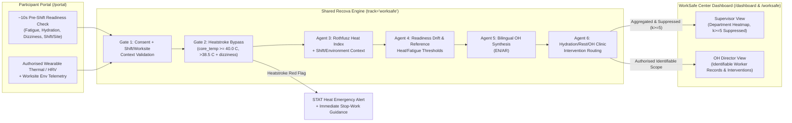

# Recova WorkSafe — Sub-Engine Design & Specification

> **Internal Track Key:** `worksafe` | **Display Label:** `Recova WorkSafe`
> **Workspace Component:** `frontend/src/features/worksafe/WorkSafeWorkspace.tsx`
> **Rules:** Zero mock/static fallback data; 100% live `/api/v1/*` + PostgreSQL 16; $k$-anonymity ($k \ge 5$) for Supervisors; `dir="rtl"` for Arabic.

---

## 1. Sub-Engine Purpose & Scope

**Recova WorkSafe** provides **workforce readiness and occupational health monitoring** (targeting heat-stress, fatigue, and shift readiness in UAE industrial/construction/logistics environments). It enforces strict role separation: **Supervisors** see only $k$-anonymous department aggregates ($k \ge 5$ suppression), while **Occupational Health (OH) Directors** access authorised identifiable worker records and medical interventions.

---

## 2. Context Engineering Flow (WorkSafe)

---

## 3. Dual-View Dashboard Design

### 3.1 Health Center Staff Dashboard (Organisation-Scoped: `primary_programme == 'worksafe'`)
- **Navigation:** `Dashboard`, `Recova WorkSafe`, `Participants` (OH Director only), `Clinical Reviews` (OH Director), `Referrals & Care` (OH Director), `Reports`, `Notices`, `Settings`.
- **Role-Differentiated Views:**
  - **Supervisor (`workforce:read_aggregate`):**
    - Readiness completion rate, department heat/fatigue risk heatmap, and active aggregate intervention counts.
    - **Strict $k$-Anonymity:** Any department/shift group with $< 5$ workers is **suppressed** on the backend (`suppressed: true`, no individual biometric scores exposed).
  - **Occupational Health Director (`workforce:read_identifiable` + `patients:read`):**
    - Identifiable worker readiness history, shift/worksite context, environmental + physiological observations (`core_temp_est_c`, `heat_index_c`, `hrv_rmssd`), and intervention sign-off.

### 3.2 Recova Overall Engine Sub-Dashboard (`WorkSafe` Tab on Platform Command)
- **Customer Centers Table:** All organisations with `primary_programme = 'worksafe'`, showing enrolled workers, pre-shift completion rate, heat/fatigue alerts, Gate 2 heatstroke bypasses, and suppressed-group counts.
- **Agent Telemetry for `worksafe`:** Rothfusz Heat Index distribution, Gate 2 emergency response time, and $k$-anonymity suppression audit log.

---

## 4. Dynamic Participant Portal (`/portal` when `enrolment.programme == 'worksafe'`)

- **~10-Second Pre-Shift Interaction:**
  - Single-screen mobile-first flow (`390px` safe): confirm shift & worksite context, rate fatigue/readiness, answer acute heat/dizziness check.
  - **Visible Result:** Immediate readiness receipt and authorised workplace instructions (e.g., standard shift clearance, hydration/shade break schedule, or immediate OH clinic stop-work escalation).
- **Emergency Response (`POR07`):** If core temp $> 38.5^\circ\text{C}$ with dizziness or $\ge 40.0^\circ\text{C}$, Gate 2 immediately surfaces red emergency cooling/medical escalation instructions.

---

## 5. Mathematical & Clinical Rules (`app/engine/scoring.py`)

- **NOAA Rothfusz Heat Index:** Computed deterministically in Agent 3/4 from ambient temperature and relative humidity.
- **Reference Fallback (`use_reference_fallback=True`):** Single-visit OSH metrics (`core_temp_est_c`, `heat_index_c`, `readiness_score`) evaluate against clinical heat/fatigue thresholds even when `baseline_status="insufficient"`.
- **$k$-Anonymity Enforcement:** Enforced at the FastAPI service/query layer (`app/services/workforce.py`) before serialization—never solely hidden in the frontend.

---

## 6. Backend Endpoint Mapping (`worksafe`)

- **Workforce & OSH (`clinical.py`):** `GET/POST /api/v1/workforce/workplaces`, `GET/POST /api/v1/workforce/departments`, `GET/POST /api/v1/workforce/assessments`, `POST /api/v1/workforce/readiness`, `GET /api/v1/workforce/heatmap` ($k$-anonymity $k \ge 5$ suppressed aggregates for Supervisors), `GET /api/v1/workforce/identifiable-risks` (OH Director identifiable scope only).
- **Participant Portal (`portal.py`):** `GET /api/v1/portal/me`, `POST /api/v1/portal/check-ins` (~10s pre-shift readiness + shift/worksite context), `POST /api/v1/portal/wearable-import`, `POST /api/v1/portal/consents`, `POST /api/v1/portal/notices/acknowledge`.
- **Engine, Heat Emergencies & Interventions (`engine.py`, `care.py`, `ops.py`):** `GET /api/v1/scoring/patient/{patient_id}`, `GET/POST /api/v1/pipeline/runs`, `GET /api/v1/agents/emergencies`, `POST /api/v1/agents/emergencies/{event_id}/resolve` (core temp $\ge 40.0^\circ\text{C}$ heatstroke bypass), `GET/POST /api/v1/interventions`, `PATCH /api/v1/interventions/{intervention_id}`, `GET /api/v1/reports/overview`.

---

## 7. Pages & Features to Create / Adjust (`worksafe`)

1. **`/worksafe` (`frontend/src/features/worksafe/WorkSafeWorkspace.tsx`):** Workplace & department setup (`workplaces`, `departments`), workplace environmental assessments, $k \ge 5$ suppressed department heatmap for Supervisors, and identifiable worker risk queue + interventions for OH Directors.
2. **`/dashboard` (Center Mode when `primary_programme == 'worksafe'`):** Role-aware KPIs (readiness completion, heat/fatigue indicators, active interventions, suppressed department summaries).
3. **`/dashboard` (Recova Engine `WorkSafe` Sub-Dashboard):** Cross-center WorkSafe summary (centers, enrolled workers, pre-shift completion, heatstroke Gate 2 bypasses, $k$-anonymity suppression counts).
4. **`/patients/[id]` (OH Director Only):** Shift/worksite context, environmental & thermal/HRV observations, Rothfusz Heat Index calculation, and intervention history. (Blocked for Supervisors.)
5. **`/portal` (WorkSafe Home):** ~10-second mobile-first pre-shift readiness check, immediate clearance/hydration/stop-work instructions, and Gate 2 red heat-emergency escalation.

---

## 8. Acceptance Criteria

- `POR03`: WorkSafe responses retain the intended shift and worksite context.
- WorkSafe vertical: Short (~10s) check-in -> appropriate worker response -> suppressed supervisor view ($k \ge 5$) + identifiable OH Director view.
